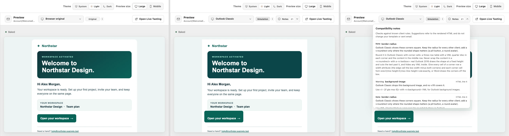
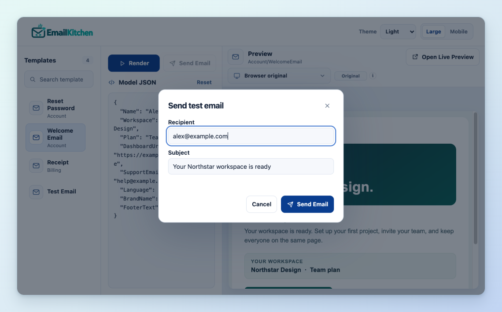

# EmailKitchen

**Preview and test Razor email templates inside your ASP.NET Core app.**

Move email markup scattered across C# strings into readable `.cshtml` views. Keep the copy and markup together, supply message data through typed C# models, and share headers, footers, and branding through Razor layouts.

EmailKitchen adds a browser workspace for email templates. Pick a recipe to preview welcome emails, receipts, and password resets with realistic sample data, then send a test through your existing mail provider.

[How it works](#how-it-works) · [Installation](#installation) · [Configuration guides](#configuration-guides)


[View the full workspace screenshot](docs/images/razor-email-workspace.webp)

## How it works

### Render a template with sample data

Find a Razor email template in the searchable **Recipes** list. Search by its name or folder as your catalog grows. **Ingredients (JSON)** starts with sample values from your C# model. Change a recipient name, adjust an amount, or switch the language, then choose **Bake** to render the preview. Razor runs your view with its layout and injected services, so you can see what your application would produce with those values.

Press **Ctrl+Enter** or **Cmd+Enter** to render from the editor. The JSON draft belongs to the selected recipe in the current workspace session. **Reset** restores sample data. Edit the template or its `CreateDefaultModel()` factory in your IDE.

Use JSON translations to preview the same template in different languages. Application services and background jobs can call `IRazorViewRendererService` to render the view to HTML with a typed model.

### Check desktop, mobile, and dark-mode layouts

Switch between **Large** and **Mobile** to check the same email at different viewport sizes. Use **Theme** to choose the preview theme: **Light**, **Dark**, or **System** (follows your device). On desktop, drag the mobile resize handle from 320 to 760 px and watch the email reflow. Emailens simulates the selected client's dark-mode adjustments when available.


On a phone, browse recipes, edit the model, render a quick preview, and send a test email if a sender is configured.


### Preview Gmail, Outlook, and Apple Mail with Emailens

Choose a client under **Preview as** to see how your email is likely to look in that inbox. **Emailens** applies that client’s HTML and CSS rules locally in your browser. Explore 21 profiles, including desktop and mobile versions of Gmail, Outlook, and Apple Mail. Switch back to **Browser original** to compare with the Razor output.

The three previews below show **Browser original**, **Outlook Classic**, and **Outlook Classic with Notes open**. The simulated Outlook view uses the solid fallback color for the gradient header. Notes explain which CSS rules may cause those differences. [Emailens engine documentation](https://docs.emailens.dev/engine)



### Watch edits in Live Preview

Click **Open Live Tasting** to open the **Live Preview** beside your IDE. With `dotnet watch`, it renders template changes with your selected model, updating the preview in place.


If a Razor edit lags behind Hot Reload, refresh the preview once the build picks it up.

### Send a test email

Click **Send Email** and enter a recipient and subject. EmailKitchen renders fresh HTML from the current model and hands it to your registered `IEmailSender`. Client simulation and theme affect the preview only. Open the message in a real inbox to verify how it arrives.



## Installation

In an **ASP.NET Core web project targeting `net10.0`**, use the .NET 10 SDK to install the package.

```bash
dotnet package add EmailKitchen
```

Register the services and map the workspace in Development in `Program.cs`.

```csharp
using EmailKitchen.Kitchen;
using EmailKitchen.Services;

var builder = WebApplication.CreateBuilder(args);
builder.Services.AddEmailKitchen();

var app = builder.Build();

if (app.Environment.IsDevelopment())
{
    app.MapEmailKitchen();
}

app.Run();
```

Run `dotnet watch` in Development, open **`/email-kitchen`** on the app's URL, and choose **TestEmail** to render the starter template. When the template folder has no Razor views, the build creates an example view, its model, a shared layout, and English translations. The default folder is `EmailKitchen/Templates`. You can preview templates without a mail sender, an API key, or Node.js.

### Configuration guides

- [Use your template folder and typed sample models](docs/configuration.md#choose-where-your-templates-live)
- [Localize messages using JSON translations](docs/configuration.md#add-a-language)
- [Connect a sender for test email delivery](docs/configuration.md#enable-test-email-delivery)
- [Render Razor email to HTML from C#](docs/configuration.md#render-razor-email-to-html-from-c)
- [Protect the workspace in a shared environment](docs/configuration.md#enable-access-in-a-shared-environment)
- [Build and install from a local NuGet feed](docs/configuration.md#install-from-source)

## License

[MIT](https://github.com/MardoszM/EmailKitchen/blob/main/LICENSE) · [Third-party notices](https://github.com/MardoszM/EmailKitchen/blob/main/EmailKitchen/Kitchen/Assets/third-party-notices.txt)
